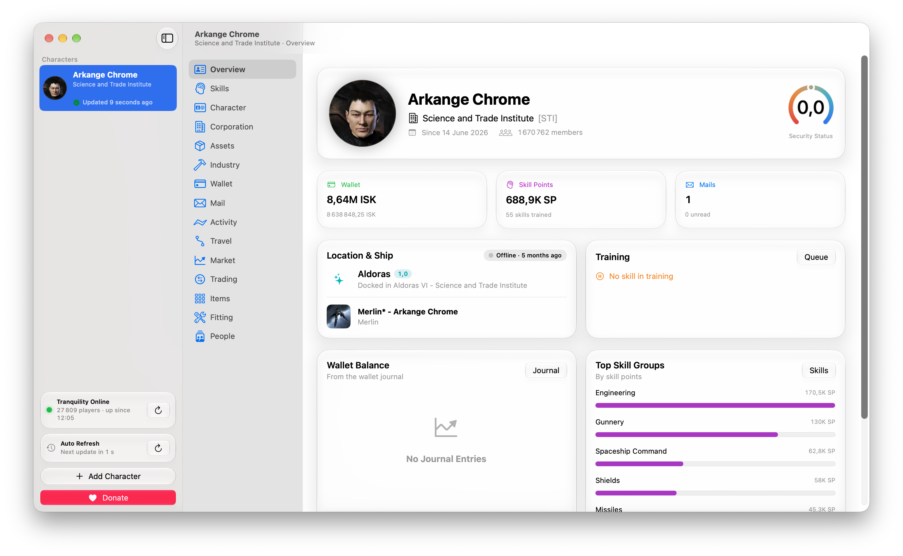

# Capsuleer One

A free, native macOS app to follow your EVE Online characters and their corporation.

**[⬇︎ Download the latest version](https://github.com/Arkange-Crome/capsuleer-one/releases/latest)** — macOS 26 or later, Apple Silicon and Intel

## Features

- **Character**: dashboard, skills, training queue, attributes, Alpha clone limits, skill planner, clones and implants, jump fatigue, loyalty points, standings, contacts, corporation history
- **Corporation**: public information and alliance; with the right roles, members and member tracking, wallets, structures (fuel, state, services), starbases, customs offices, industry jobs, market orders, contracts, contacts, standings, medals
- **Money and industry**: wallet journal and transactions, market orders, contracts, assets with their value, industry jobs, planetary colonies, mining ledger kept beyond the 30 days of ESI, moon mining
- **Market and trading**: order books, price history, comparison of the trade hubs, hauling trade calculator
- **Tools**: EVE mail client, killmails, notifications, calendar, route planner that sends the destination to the game, fitting simulator with EFT import, item browser
- **In the game**: set destinations and waypoints, open the info or market windows from a right click
- Several characters, in English, French, Spanish and Russian

## Privacy

- Sign in with the official **EVE SSO**, with the scopes you choose.
- Your tokens stay **on your Mac, in the macOS Keychain**. No server, no account, no analytics.
- The app only talks to CCP's servers (ESI, image server, login).

## Installation

I don't have a paid Apple developer account: the app is **not notarized**, so macOS blocks it the first time.

1. Download the `.dmg` from the [latest release](https://github.com/Arkange-Crome/capsuleer-one/releases/latest), open it and drag **Capsuleer One** to **Applications**.
2. Open the app. macOS says it cannot verify it: click **Done**.
3. Open **System Settings > Privacy & Security**, scroll down and click **Open Anyway**, then confirm.
4. Open the app again. macOS won't ask anymore.

The first time, click **Always Allow** when macOS asks for your Keychain password. It asks once more after each update.

You can check your download with the SHA-256 given in each release: `shasum -a 256 Capsuleer-One-*.dmg`

## Support

Bugs and ideas: [open an issue](https://github.com/Arkange-Crome/capsuleer-one/issues) or send an EVE mail to **Arkange Crome**.
Capsuleer One is free, with no locked feature. ISK donations to Arkange Crome are welcome, never required.

---

*EVE Online and the EVE logo are the registered trademarks of CCP hf. All rights are reserved worldwide. All other trademarks are the property of their respective owners. EVE Online, the EVE logo, EVE and all associated logos and designs are the intellectual property of CCP hf. All artwork, screenshots, characters, vehicles, storylines, world facts or other recognizable features of the intellectual property relating to these trademarks are likewise the intellectual property of CCP hf. Capsuleer One is not affiliated with CCP hf.*
